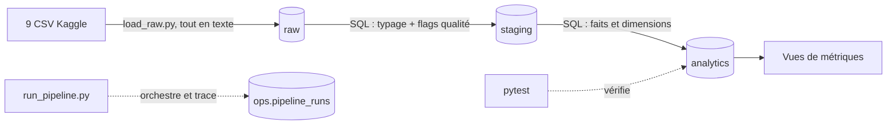

# Olist Data Platform

Pipeline Data Engineering de bout en bout sur le dataset
[Olist Brazilian E-Commerce](https://www.kaggle.com/datasets/olistbr/brazilian-ecommerce) :
CSV bruts → PostgreSQL (raw → staging → analytics) → métriques SQL,
avec tests automatiques et historique d'exécution.

## Objectif

Transformer 9 fichiers CSV en données fiables et testées, capables de répondre à des
questions métier (ventes mensuelles, vendeurs, catégories, retards de livraison, clients),
sans double comptage.

## Architecture



| Couche | Rôle |
|---|---|
| `raw` | Copie fidèle des CSV (texte), avec `_source_file` et `_loaded_at` |
| `staging` | Types corrects (timestamp, numeric), flags de qualité, aucune ligne supprimée |
| `analytics` | 2 tables de faits (`fact_orders`, `fact_order_items`), 3 dimensions, 5 vues de métriques |
| `ops` | Historique de chaque étape du pipeline (statut, durée, erreur) |

## Technologies réellement utilisées

Python (pandas, SQLAlchemy), PostgreSQL 16, SQL, Docker Compose (PostgreSQL uniquement),
pytest, Git/GitHub.

Non implémentés : Airflow, dbt, Spark, Kafka, CI/CD, dashboard. Voir « Évolutions possibles ».

## Lancer le projet

Prérequis : Python 3.12, Docker Desktop, les CSV Olist dans `data/raw/`.

```powershell
py -3.12 -m venv .venv
.\.venv\Scripts\Activate.ps1
pip install -r requirements.txt
# créer .env à partir de .env.example
docker compose up -d
python scripts\run_pipeline.py
pytest -v
```

## Règles métier

- **Chiffre d'affaires** : somme de `price` (sans frais de port), hors commandes `canceled` et `unavailable`.
- **Client** : identifié par `customer_unique_id` (`customer_id` est généré par commande).
- **Avis** : une commande peut en avoir plusieurs ; on garde le plus récent.
- **Croissance mensuelle** : calculée seulement si les deux mois comparés sont consécutifs et ont au moins 100 commandes (seuil choisi par l'auteur).
- **Livraisons** : seules les commandes `delivered` avec date de livraison sont analysées.

## Qualité des données : constats mesurés

- 775 commandes sans article (statuts `unavailable`, `canceled`, etc.) : conservées, flag `has_items`.
- 1 commande livrée sans paiement, 8 livrées sans date de livraison, 6 annulées avec date : conservées et signalées.
- `review_id` non unique : 98 410 valeurs distinctes pour 99 224 lignes.
- 303 commandes dont le paiement diffère de articles + port (264 en plus, 39 en moins). Cause non prouvée : les paiements en plusieurs fois dominent les écarts positifs (hypothèse : intérêts). Les métriques utilisent `price`, donc ne sont pas affectées.
- La table `geolocation` est chargée en `raw` mais pas encore utilisée.

## Tests et idempotence

`pytest` vérifie : grain des faits, absence de double comptage (articles et paiements), un avis par commande, valeurs des flags, validité des montants et notes, présence des vues.
Le pipeline reconstruit staging et analytics à chaque exécution et redonne les mêmes totaux.

## Limites

- Prototype local, pas un système de production : pas de planification, d'alerte ni de gestion des secrets au-delà de `.env`.
- Chargement `replace` : adapté à un dataset statique, pas à un flux incrémental.
- Les tests d'intégration supposent une base alimentée ; les valeurs de référence (775, 1, 8, 6) sont propres à ce jeu de données.

## Évolutions possibles

Orchestration (Airflow), transformations dbt, CI GitHub Actions, dashboard Metabase.